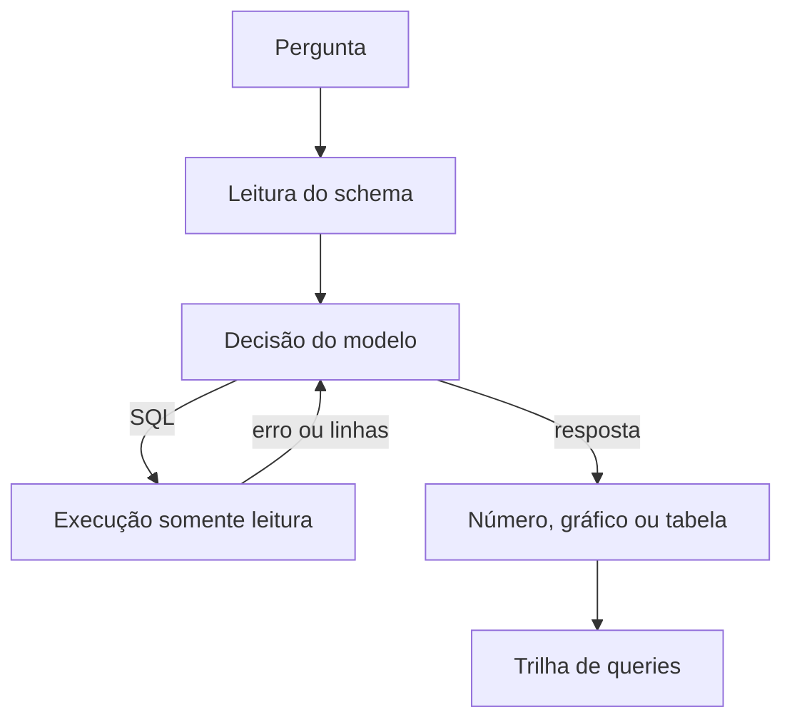

# FRANQ

Assistente de dados do desafio técnico 1. A pessoa pergunta em português, o sistema lê o schema do SQLite na hora, escreve a consulta, executa em modo somente leitura e, se o banco recusar o SQL, corrige e tenta de novo. A tela mostra o número, o gráfico ou a tabela, e a trilha de consultas.

O PDF descreve as tabelas `clientes`, `compras`, `suporte` e `campanhas_marketing`. O arquivo `anexo_desafio_1.db` também tem, em `clientes`, as colunas `valor_total_gasto` e `data_ultima_compra`, e as chaves estrangeiras de `cliente_id`. Nada disso está fixo no código: a descrição entra no prompt a cada pergunta.

## Executar

Na pasta `desafio1`:

```powershell
python -m venv .venv
.\.venv\Scripts\Activate.ps1
pip install -r requirements.txt
copy .env.example .env
```

Preencha `OPENAI_API_KEY` no `.env`. Para Groq, OpenRouter, Ollama ou outro endpoint compatível, use também `OPENAI_BASE_URL` e `OPENAI_MODEL`.

```powershell
streamlit run app.py
```

No terminal:

```powershell
python -m src "Quantos clientes interagiram com campanhas de WhatsApp em 2024?"
```

O banco padrão é `../anexo_desafio_1.db`. Outro arquivo: `DB_PATH` no `.env`, ou `--db` no comando.

Os testes não chamam o modelo:

```powershell
pip install -r requirements-dev.txt
pytest
```

## Arquitetura



A tela guarda a conversa inteira. Cada pergunta nova recebe as trocas anteriores, com a resposta, a SQL e uma amostra do resultado. "Desses", "em 2024?" e "e de SC?" continuam no recorte já combinado e somam o filtro novo. Uma pergunta que abre outro assunto, troca o mês ou pede app e não app segue só o pedido novo. Os números dessa pergunta ainda saem de uma consulta nova.

O grafo está em LangGraph, com três nós:

1. `decide` recebe o schema, a pergunta e o que já foi tentado, e devolve uma decisão estruturada: nova consulta ou resposta final.
2. `execute` roda uma única instrução `SELECT` ou `WITH`. A conexão abre com `mode=ro` e `PRAGMA query_only`. Um validador recusa escrita, mais de uma instrução e comentário que esconda outro comando. O literal da pergunta pode conter a palavra `drop` sem ser bloqueado.
3. Se o SQLite devolve erro, o texto volta para `decide`. Três erros seguidos, ou cinco consultas, encerram a pergunta com o que já tiver sido obtido.

A tela é Streamlit. Lista vira tabela, comparação vira barra, tendência vira linha, número único vira indicador. A última consulta válida é a fonte do desenho. O expansor "Como cheguei nessa resposta" mostra o raciocínio, o SQL e o erro, quando houve.

O glossário no prompt fixa as contas que o enunciado deixa em aberto: cliente distinto, reclamação, interação, média por categoria, mês sem ano e janela de um ano. O SQL continua sendo gerado na hora. As consultas de referência abaixo servem para conferir o resultado; o agente não as consulta.

## Consultas de referência

Premissas usadas nestes números:

- "em maio" cai em 2025. A primeira compra da base é de 2024-07-22, então não há maio de 2024.
- "clientes que compraram" conta pessoas, não linhas de compra. Empate desempata pelo nome do estado.
- média da categoria = compras ÷ clientes distintos que compraram aquela categoria.
- reclamação é `tipo_contato = 'Reclamação'`. Não resolvida é `resolvido = 0`.
- "último ano" vai da data máxima de contato até um ano antes. Nessa base a janela cobre o histórico inteiro: 97 reclamações, de 2024-07 a 2025-07.

| Pergunta | Resultado |
|---|---|
| 5 estados com mais clientes que compraram via app em maio | São Paulo 6, Minas Gerais 3, Santa Catarina 3, Alagoas 2, Espírito Santo 2 |
| Clientes que interagiram com WhatsApp em 2024 | 17 |
| Média de compras por cliente, por categoria | Roupas 2,21; Viagens 2,16; Livros 1,98; Serviços 1,96; Eletrônicos 1,92; Alimentos 1,88 |
| Reclamações não resolvidas por canal | Telefone 19, Chat 18, E-mail 14 |
| Tendência de reclamações por canal no último ano | série mensal de 2024-07 a 2025-07, três canais, 97 reclamações |

`valor_total_gasto` somado dá 248.173,11. A soma de `compras.valor` dá 740.013,68. Por isso o prompt manda recalcular gasto a partir de `compras`.

## O que eu mudaria depois

- Avaliar o modelo ao vivo contra as cinco consultas de referência e falhar o CI quando o número divergir.
- Tirar o glossário do prompt e colocar numa camada semântica versionada, para a definição de "reclamação" mudar sem editar texto de modelo.
- Reconciliar `valor_total_gasto` com a soma das compras, ou apagar a coluna se ela for resquício.
- Limitar custo por pergunta e cachear o schema quando o arquivo não mudar. A tela já cacheia a leitura; o agente relê de propósito, porque o banco é pequeno.
- Pedir confirmação antes de uma consulta que só varre fato bruto, quando o volume deixar de caber em mil linhas.
- Autenticação e recorte por usuário, se a mesa sair da diretoria e for para mais gente.
