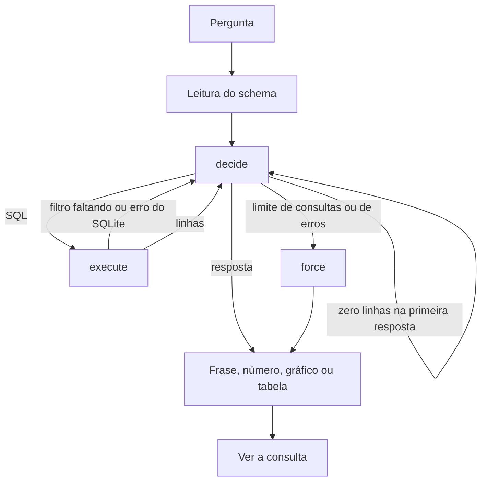

# FRANQ

Assistente de dados do desafio técnico 1. A pessoa pergunta em português. O sistema lê o schema do SQLite na hora, escreve uma consulta, executa em modo somente leitura e, se o banco recusar o SQL ou o complemento da conversa perder um filtro, devolve o erro ao modelo para ele corrigir. A tela mostra a frase, o número, o gráfico ou a tabela, e a consulta que chegou no resultado.

O PDF descreve as tabelas `clientes`, `compras`, `suporte` e `campanhas_marketing`. O arquivo `anexo_desafio_1.db` também tem, em `clientes`, as colunas `valor_total_gasto` e `data_ultima_compra`, e as chaves estrangeiras de `cliente_id`. Nada disso está fixo no código: a descrição entra no prompt a cada pergunta.

## Executar

Na pasta `desafio1`:

```powershell
python -m venv .venv
.\.venv\Scripts\Activate.ps1
pip install -r requirements.txt
copy .env.example .env
```

Preencha `OPENAI_API_KEY` no `.env`. Para Groq, OpenRouter, Ollama ou outro endpoint compatível com a API da OpenAI, use também `OPENAI_BASE_URL` e `OPENAI_MODEL`.

```powershell
streamlit run app.py
```

A tela abre em `http://localhost:8501`.

No terminal, a mesma pergunta imprime a resposta e cada consulta:

```powershell
python -m src "Quantos clientes interagiram com campanhas de WhatsApp em 2024?"
```

Código de saída `2` quando falta a chave. Código `1` quando o arquivo do banco não existe.

Com o Docker Desktop aberto, na mesma pasta:

```powershell
docker compose up --build
```

O Compose publica a porta `8501`, lê o `.env` se ele existir e monta `../anexo_desafio_1.db` em `/data/anexo_desafio_1.db`, somente leitura. `DB_PATH` dentro do container aponta para esse arquivo, então um caminho do Windows no `.env` não entra na imagem. A chave também não entra na imagem: ela só existe no processo, via `env_file`.

Os testes não chamam o modelo:

```powershell
pip install -r requirements-dev.txt
pytest
```

## Configuração

| Variável | Padrão | Uso |
|---|---|---|
| `OPENAI_API_KEY` | vazio | Obrigatória. Sem ela o agente não começa. |
| `OPENAI_BASE_URL` | vazio | Endpoint compatível. Vazio usa a OpenAI. |
| `OPENAI_MODEL` | `gpt-4o-mini` | Modelo do cliente. Temperatura 0. |
| `DB_PATH` | `../anexo_desafio_1.db` | Caminho do SQLite. Absoluto vale como está. Relativo resolve a partir da pasta `desafio1`. |
| `MAX_QUERIES` | `5` | Consultas por pergunta. O mínimo efetivo é 1. |

O CLI aceita `--db` no lugar de `DB_PATH` só naquela execução. A tela usa `DB_PATH`.

## Como uma pergunta anda



O grafo está em LangGraph, com três nós. O limite de recursão é 40.

1. `decide` recebe o schema, a pergunta, a conversa anterior e o que já foi tentado nesta pergunta. A saída é estruturada, por function calling: `query` ou `answer`, com o SQL, o propósito, a frase e o tipo de desenho (`metric`, `table`, `bar`, `line` ou `none`).
2. `execute` roda uma única instrução. Antes do banco, confere se um complemento da conversa ainda carrega os filtros combinados. Se faltar algum, a consulta nem chega no SQLite: o texto do que faltou volta para `decide` como erro. Se o SQLite devolver erro, o texto também volta.
3. `force` encerra quando a pergunta estourou o limite. Três erros seguidos, ou cinco consultas (`MAX_QUERIES`), disparam esse nó. Se houve alguma consulta aceita, a frase aponta a última tabela válida. Se todas falharam, a frase aponta o erro do banco.

Uma consulta que volta zero linhas não pode ser a primeira resposta final. O grafo marca `empty_recheck`, devolve o passo para `decide` e o prompt manda conferir o intervalo da coluna antes de dizer que não há registros. Isso pega o caso de maio filtrado como `2024-05`, ano em que a base ainda não tem compra: a primeira compra é de 2024-07-22.

A decisão usa a última consulta bem-sucedida como fonte do desenho. Se o modelo pedir `answer` com a frase vazia, a tela recebe um texto de reserva: a tabela, quando há linhas, ou a frase de que não há dados.

## Memória e complemento

A conversa inteira entra no prompt de cada pergunta nova: a pergunta, a resposta (cortada em 500 caracteres), a última SQL bem-sucedida e até 8 linhas do resultado. Isso é memória. Não trava a pergunta seguinte num mês ou num canal.

O travamento existe só quando a pergunta é um complemento. `src/follow.py` classifica o texto e, nesse caso, exige que a SQL nova mantenha os predicados já combinados. `execute` recusa a consulta que os deixa cair, e o modelo tenta de novo.

É complemento quando acontece uma destas:

- há anáfora: "desses", "esses", "deles", "você disse", "você me trouxe", "como que tem", e as formas parecidas;
- há "no total", "num total", "um total", "sem ser", "fora de" ou "exceto";
- a frase tem no máximo seis palavras e começa com "e", "em", "de", "do", "da", "pelo", "pela", "no", "na", "qual", "quais", "tem", "só", "somente", "mas" ou "sem".

Uma pergunta longa, mesmo começando com "e", segue só o pedido novo. "E em abril, quantos foram do app e quantos não foram?" não herda maio.

Os predicados saem da SQL anterior: ano, mês, e igualdade em `canal`, `estado`, `tipo_contato`, `nome_campanha`, `categoria`, `genero`, `profissao`, `cidade`, `interagiu` e `resolvido`. A cadeia percorre os turnos. Um turno que não é complemento substitui o recorte. Um complemento soma o filtro novo e pode soltar o antigo.

O que o complemento pode mudar:

- "e em junho?" troca o mês e mantém o canal.
- "num total", "no total", "o ano todo", "em geral" e "histórico" soltam o mês e o ano. O canal fica.
- "sem ser em maio", "fora de maio" e "exceto maio" exigem mês diferente de `05`. Não selecionam maio.
- "quantos foram do app e quantos não foram", "qualquer canal" e "todos os canais" soltam o canal.
- "por estado" e "todos os estados" soltam o estado. Citar outro estado troca o estado.
- Se o complemento cita um ano, toda data em jogo na SQL nova precisa estar nesse ano. Entram `data_compra`, `data_envio`, `data_contato` e `data_ultima_compra` quando aparecem no texto, e também a data da tabela citada: `compras` puxa `data_compra`, `campanhas_marketing` puxa `data_envio`, `suporte` puxa `data_contato`.

Um exemplo que o código cobre: 17 clientes interagiram com WhatsApp em 2024. "Tem algum desses que é de SC?" tem de continuar em 2024, e são duas pessoas. "E quais desses compraram pelo app?" tem de continuar em Santa Catarina e em 2024. "Em 2024?" de novo tem de filtrar a data de compra, não só a data da campanha.

O prompt também avisa o modelo, em linguagem, para manter o recorte quando a pergunta completa a anterior e para soltá-lo quando o assunto muda. A recusa em `execute` é o que impede a SQL de ignorar esse aviso.

## Leitura do banco

A conexão abre com URI `file:...?mode=ro` e `PRAGMA query_only = ON`. O validador, em `src/sql_guard.py`, aceita uma única instrução `SELECT` ou `WITH`. Recusa escrita, mais de um comando e comentário que esconda outro comando. Literais e comentários são apagados antes dessa checagem, então a palavra `drop` dentro de um texto da pergunta não bloqueia a consulta, e um ponto e vírgula dentro de string continua sendo uma instrução.

O resultado devolve no máximo 1000 linhas. Acima disso, `truncated` fica verdadeiro e a resposta segue com a amostra.

O schema é lido de `sqlite_master`, `PRAGMA table_info` e `PRAGMA foreign_key_list`. Para cada coluna o prompt recebe a contagem de distintos e, quando a coluna é curta, os valores com a frequência. Datas e números longos entram como mínimo e máximo. O texto do schema é marcado como dado, não como instrução.

`valor_total_gasto` somado dá 248.173,11. A soma de `compras.valor` dá 740.013,68. O glossário do prompt manda recalcular gasto a partir de `compras`.

## Tela

A interface é Streamlit, com a logo FRANQ, fundo claro e a fonte Outfit. A barra lateral lista as tabelas, a contagem de linhas e as colunas. Os cinco cartões são as perguntas do PDF.

Enquanto o agente trabalha, a pergunta fica na tela com o logo pulsando e as linhas "Lendo a base", "Montando a consulta" e "Conferindo o número". A resposta nova é revelada ao longo de 5 segundos. As respostas anteriores aparecem inteiras. Quem prefere menos movimento no sistema vê o texto completo de uma vez.

O desenho usa a última consulta válida:

- uma célula numérica vira o número azul, mesmo se o modelo tiver pedido tabela;
- uma lista vira tabela, na altura das linhas;
- comparação vira barra;
- tendência vira linha;
- várias linhas pedidas como indicador viram barra, se houver eixos, ou tabela.

Gráfico sem eixo utilizável cai para tabela. As cores seguem o azul da logo. O expansor **Ver a consulta** mostra o raciocínio, o SQL, o erro quando houve, e a tabela de apoio quando o desenho principal é gráfico.

A conversa vive em `session_state`. "Limpar conversa" zera o histórico. O schema da barra é cacheado pela data de modificação do arquivo. O agente relê o schema a cada pergunta.

## Arquivos

| Caminho | Papel |
|---|---|
| `app.py` | Tela, histórico, indicador, tabela e gráfico. |
| `src/agent.py` | Grafo `decide`, `execute` e `force`. |
| `src/prompts.py` | Prompt de sistema, glossário e memória da conversa. |
| `src/follow.py` | O que conta como complemento e quais filtros a SQL tem de manter. |
| `src/database.py` | Conexão somente leitura, schema e teto de 1000 linhas. |
| `src/sql_guard.py` | Uma instrução, só leitura. |
| `src/viz.py` | Escolha do desenho e figuras Plotly. |
| `src/config.py` | `.env`, caminho do banco, modelo e limite de consultas. |
| `src/cli.py` | `python -m src`. |
| `docker-compose.yml` | Sobe a tela com o banco montado só para leitura. |
| `tests/` | Schema, validador, consultas de referência, grafo com modelo simulado e a cadeia de complementos. |

## Consultas de referência

Premissas usadas nestes números:

- "em maio" cai em 2025. A primeira compra da base é de 2024-07-22, então não há maio de 2024.
- "clientes que compraram" conta pessoas, não linhas de compra. Empate desempata pelo nome do estado.
- média da categoria = compras ÷ clientes distintos que compraram aquela categoria.
- reclamação é `tipo_contato = 'Reclamação'`. Não resolvida é `resolvido = 0`.
- "último ano" vai da data máxima de contato até um ano antes. Nessa base a janela cobre o histórico inteiro: 97 reclamações, de 2024-07 a 2025-07.

| Pergunta | Resultado |
|---|---|
| 5 estados com mais clientes que compraram via app em maio | São Paulo 6, Minas Gerais 3, Santa Catarina 3, Alagoas 2, Espírito Santo 2 |
| Clientes que interagiram com WhatsApp em 2024 | 17 |
| Média de compras por cliente, por categoria | Roupas 2,21; Viagens 2,16; Livros 1,98; Serviços 1,96; Eletrônicos 1,92; Alimentos 1,88 |
| Reclamações não resolvidas por canal | Telefone 19, Chat 18, E-mail 14 |
| Tendência de reclamações por canal no último ano | série mensal de 2024-07 a 2025-07, três canais, 97 reclamações |

O glossário no prompt fixa essas contas quando a pergunta não define outra. O SQL continua sendo gerado na hora. As consultas de referência servem para conferir o resultado; o agente não as consulta. Os testes em `tests/test_reference_queries.py` rodam esse SQL direto no arquivo.

## O que eu mudaria depois

- Avaliar o modelo ao vivo contra as cinco consultas de referência e falhar o CI quando o número divergir.
- Tirar o glossário do prompt e colocar numa camada semântica versionada, para a definição de "reclamação" mudar sem editar texto de modelo.
- Reconciliar `valor_total_gasto` com a soma das compras, ou apagar a coluna se ela for resquício.
- Limitar custo por pergunta e cachear o schema quando o arquivo não mudar. A tela já cacheia a leitura; o agente relê de propósito, porque o banco é pequeno.
- Pedir confirmação antes de uma consulta que só varre fato bruto, quando o volume deixar de caber em mil linhas.
- Autenticação e recorte por usuário, se o assistente sair do uso local e for para mais gente.
